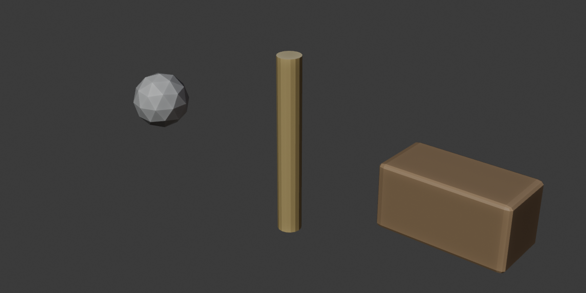
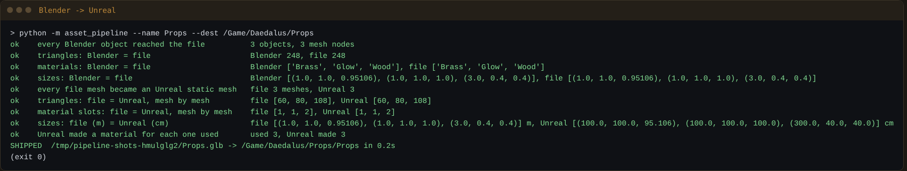
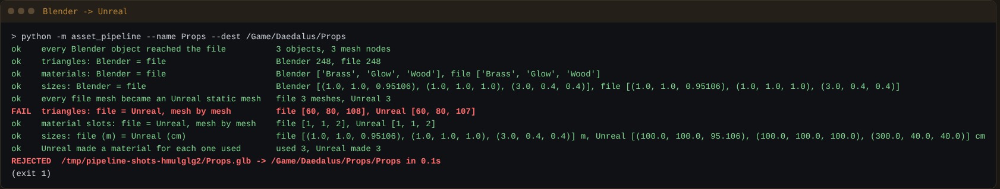
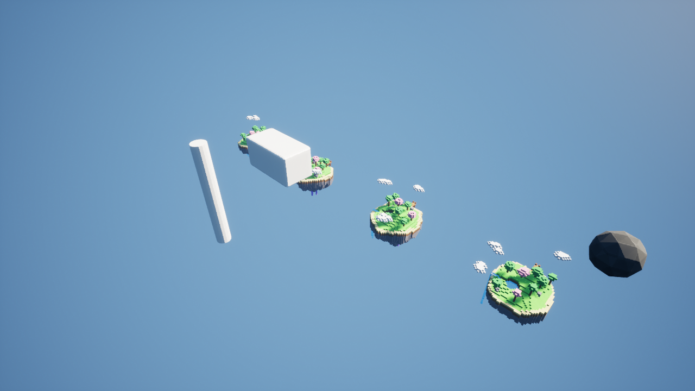

# Claude Asset Pipeline

Moves models from Blender into Unreal and proves nothing was lost on the way. Any agent can run it: Claude, Grok
bots, scripts or CI. It uses only the Python standard library.



```
python -m asset_pipeline --name Lamp --objects Lamp,Post --dest /Game/Daedalus/Props --report lamp.json
```

1. **Blender** (the [Claude Blender Connector](https://github.com/RicheyWorks/claude-blender-connector),
   port 9876) exports the objects to one `.glb`, with modifiers applied. It reports the triangles,
   materials and size of each object.
2. **The file** is read here, with no 3D library. It is the witness between the two editors.
3. **Unreal** (the [Claude Unreal Connector](https://github.com/RicheyWorks/claude-unreal-connector),
   port 9877) imports the `.glb` with an automated Interchange import, so no dialog opens. It reports the
   static meshes and materials it made.
4. **The judge** compares Blender with the file, and the file with Unreal: object and mesh counts,
   triangles, material slots, and sizes (metres to centimetres, sorted so the Y-up/Z-up swap doesn't
   matter). It prints `SHIPPED` and exits 0, or `REJECTED` and exits 1.



One triangle lost on import, and the judge names the check:



Both editors must be open, with their connectors running, on the same computer.

From code: `from asset_pipeline import ship; report = ship.ship("Lamp", ["Lamp"])`.

## Harness

| Suite | What it proves |
|---|---|
| `harness/glb_test.py` | The `.glb` reader on hand-made files: indexed and non-indexed triangles, lines, instancing, and broken files refused (9 cases) |
| `harness/judge_test.py` | One good shipment passes, and each kind of loss fails exactly the check it should (14 cases) |
| `harness/e2e.py` | Real Blender (`bpy`) exports and the Unreal stand-in imports the real `.glb`. Five planted losses (a mesh, a triangle, a slot, the units, the materials) are each REJECTED by the right check, and the CLI exit codes are checked (17 cases) |
| `harness/mutate.py --e2e` | Breaks the judge, the `.glb` reader and both editor scripts on purpose. Every break must turn a suite red. Results go to `ledgers/mutants.json` |
| `harness/run_all.py` | Runs every suite and prints n/m |
| `harness/shots.py` | Makes this README's screenshots from real runs, so they never go stale |

`e2e.py` finds the two connector repos as siblings of this folder, or you can pass `--blender-connector`
and `--unreal-connector`.

## Proven live

On UE 5.8.3 (Windows 11), the same three props went through a real Interchange import: **SHIPPED, 9/9 checks**
(`ledgers/live-ue58.json`). That run showed that Interchange makes one static mesh per object and bakes each
object's scale into it (the 2× crate is 200 cm). The reader, the judge and the stand-in now model that.



## Not verified here

The stand-in imports the way Interchange did live: one StaticMesh per object with its scale baked in, and a
bare mesh given the default material slot. Rotated objects are not size-checked exactly (only quarter turns). On a real UE 5.8 editor, run the CLI once and read the report. If
Interchange merges meshes or drops degenerate triangles, the judge will say REJECTED, and the report
shows where.

MIT

## Combat asset handoff (combat-slice/v1)

Checks a combat slice's art before it reaches Unreal: weapon sockets (`SOCKET_<Name>` nodes), enemy skeleton (joint count and required joints) and LOD0..LODn, environment collision (`UCX_`/`UBX_`/`USP_`/`UCP_`), and optional triangle budgets. Passing assets are imported through `ship.land` with `--import`; failing assets are never imported. Writes `report.json` and `REPORT.md`.

```
python -m asset_pipeline.combat_handoff --spec specs/combat-slice-1.json --folder <art dir> --out <dir> [--import]
python harness/combat_handoff_test.py   # offline, no editor
```

New slice: write a new spec. New kind of asset: add a check function to `ROLES`.
### What is still missing, and sample files

```
python -m asset_pipeline.combat_report --spec specs/combat-slice-1.json --folder <art dir> --queue <art dir>\QUEUE.md --out <dir>
python -m asset_pipeline.combat_fixtures --spec specs/combat-slice-1.json --out <dir> [--defect Enemy_Slice1_Guard=lods]
python harness/combat_report_test.py   # offline, 36 cases
```

`combat_report` turns the spec plus the art folder into `TODO-FOR-BLENDER-TEAM.md` (and `todo.json`): per asset MISSING / FIX / READY, its art queue row, what the file must contain, and for every failed check how to fix it in Blender. It reads files only (never Unreal, never Blender, no import) and exits 0 only when the whole slice is READY. `combat_fixtures` writes minimal hand-made sample `.glb` files built from the spec (one passing set, or one asset with a named defect: `socket`, `skin`, `joints`, `lods`, `lod-order`, `tris`, `collision`, `nocollision`, `broken`) so the team can see what a passing file contains. They are test shapes, never art: do not import them.

