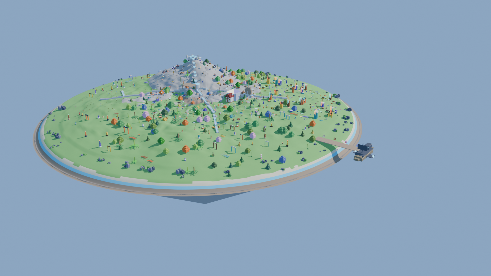

# Blender Boss Island (flagship, contest entry)
**Owner:** blender-team (Blender Boss). Only blender-team edits this island.
**ARK_ORIGIN:** `-6000000, 6000000, 0` (cm). Sublevel `/Game/BlenderBoss/Maps/BlenderBossIsland`.
**Size:** 240 m across, double the planned size. **NFT:** minted as one of the 10,000 Daedalus islands, flagship tier. The owner's token holds the island seed and the herb-spiral layout.

## Lore
A floating workshop isle carved in terraces by the Blender Boss, who built every prop in the sky. A spiral herb garden winds out from its heart, a quarry hill rises in the northwest, and the crew's crafting plaza circles the centre. An ark sits moored at the eastern pier, ready to tow neighbouring islands.

## Contents
- **500 unique island-only models** `Prop_BBIsle_<Family>_<nn>`: 25 structural families (arch, banner, barrel, beehive, bell, bench, bridge, cart, coop, crate, fence, lamp, obelisk, planter, scarecrow, shelf, sign, statue, sundial, table, tent, totem, trough, well, windmill). Each item is seeded with its own counts, tiers and proportions, so none is just a recolour. Placed in spaced zones: farm by the pen, village round the plaza, monument ring.
- **Catalog:** orchard and grove trees, the herb spiral, a bloom meadow, quarry ore nodes, a crafting plaza (forge, furnace, anvils, cooking pots, brewing still, loom, mill), a livestock pen, 12 crew NPCs (the Cook works the plaza pot), shore rocks, and an ark dock with a moored `Veh_Ark`.
- About 1003 placements and 684 unique meshes. Layout is in `data/islands/blenderboss/layout.json`.

## Water chain
1. **Sources.** The **quarry spring** pool sits on the NW hill at (-35, 30). A **rain catchment roof** with a gutter stands over the plaza edge.
2. **Storage.** Both feed the stone **cistern** at (-12, 8). The spring reaches it on an arched **aqueduct**.
3. **Distribution.** Stone channels with open water run from the cistern:
   - **Herb spiral irrigation:** cistern to (-48, -34), then the inner ring at (-62, -46). The core rings get water first, which is why they regrow fastest (see Spiral Steeping).
   - **Orchard:** cistern to (30, -20) to (50, -40).
   - **Bloom meadow:** a branch off the herb line to (-66, -22).
   - **Livestock:** cistern to the **waterwheel** at (30, 20). It drives the mill and lifts water along its race to the pen, where four **troughs** stand at (52, 40).
4. **Drinking water.** The plaza **well** at (16, -10) draws from the cistern's water table.
5. **Dry spell.** The cistern holds 3 in-game days. Channels shut off from the outside in: meadow, then orchard, then pen. The well and the herb core are always last.

## Herb mechanic: Spiral Steeping
Herbs grow in a spiral. A brew's effect depends on which **ring** each herb comes from.
- **Core** (rings 1-2): strength x2, duration x0.5.
- **Weave** (rings 3-4): lets two effects stack.
- **Drift** (rings 5+): duration x2, strength x0.5.

Base effects: Aloe/Comfrey heal; Thistle/Nettle shield; Mint/Ginger speed; Sage/Lavender give clarity (reveals ore); Moonflower gives night vision.
Three herbs from three different rings, steeped in the Cooking Pot, make a **Spiral Draught**. It carries the core herb's effect, adds the weave herb's effect, and lasts as long as the drift herb.
Harvested rings regrow from the inside out, and the irrigation reaches the core first, so the core stays scarce but steady.

## Livestock and food loop
- **Grazers and Hoppers** in the pen eat bloom-meadow flowers and orchard windfall and drink from the troughs. They give milk, wool and eggs.
- **Crawlers** clear quarry slag into "grit", which fertilises the herb spiral (+1 regrow tier).
- **Crew and players** eat orchard fruit, cooked eggs and milk (Cooking Pot), and herb broths. They drink from the well.
- **Fertility.** Manure and grit feed the soil, and the irrigation channels water it.
- **Ore and tools.** Quarry ore goes to the smelter and forge, which make tools, pen fences and ark parts. The ark trades surplus for seeds from linked NFT islands.
- **Self-sufficient.** Cut off, the island survives on orchard + livestock + herbs + the spring and rain.

## Build and editor turn
- Blender (hidden, headless): `blender -b --factory-startup --python tools/islands/blenderboss/flagship.py -- <bot-team>\art <out.png>`. It writes `art\glb\Prop_Island_Flagship_BlenderBoss.glb` (whole scene), `art\glb\Prop_Island_BlenderBoss_Base.glb` (terrain, underside, pier, water chain), `art\flagship\layout.json` and the hero render. Models: `bbkit.py` (families) + `bbisle.py` (500 items, `BBISLE_BATCH=0..4`, built by blender-harness `assets/headless.py`).
- Editor turn, **granted slot only**: `powershell -File tools\islands\blenderboss\bb_turn.ps1`. It sends `bb_island_ue.py` through `ue_send.py` (it imports the base and any missing glbs, places the layout in its own sublevel, adds a hero cam and saves only that sublevel), then runs tidy to close the Content Browser and Message Log.
- Large binaries (glb/blend) are not tracked in this repo. They live in `bot-team\art\glb` and `art\flagship`.
