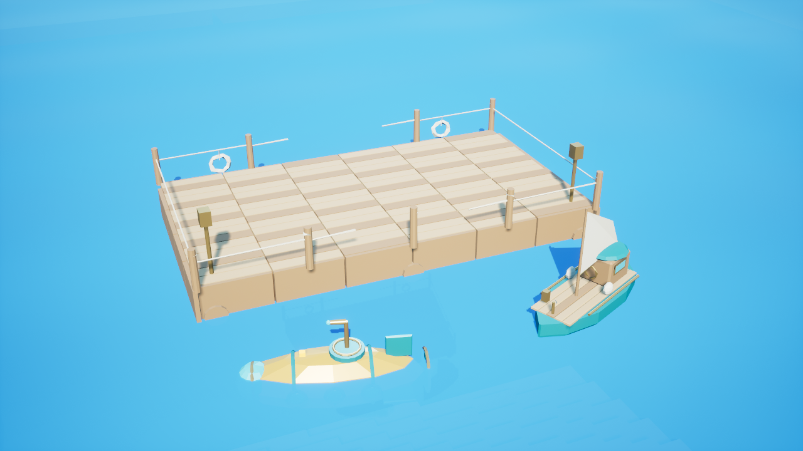

# Ocean harbor delivery

Three original static props extend the existing Ocean terrain and native vessel framework: Tide Skiff (1,766 triangles), Coral Submarine (6,676) and Harbour Dock (8,352). Total 16,794 triangles. They add no enemy, friendly or unicorn population credit. The raw, angular meshes retain a consistent teal, ochre, brass and wood palette.

`data/art/ocean/ocean-vessels.zip` contains the Blender source, three validated GLBs, BBA and manifest. `ocean-native-content.zip` contains only `Content/Ocean` assets from the private UE5.8 host. `delivery.json` records archive and member hashes. Extract native content under the DaedalusLink plugin only in an agreed import turn. Existing content at the same paths must be reviewed before replacement. The production catalog stays `blender_only` until shared-world import is acknowledged; private imports are recorded separately in Excel.

## Reproduction

- Run Blender with `--background --python-exit-code 1 --python tools/blender/ocean_vessels.py -- FRESH_OUTPUT`. Optional `--reuse-vessels PREVIOUS_OUTPUT` freezes the accepted skiff and submarine exports while extending the kit.
- In a fresh private full-plugin host, enable PythonScriptPlugin and EditorScriptingUtilities. Set `OCEAN_VESSEL_DELIVERY` to the extracted source delivery and `OCEAN_SCENE_ASSET_PROOF` to a new proof path. Execute `tools/unreal/ocean_scene_assets.py` through the editor Python commandlet. It reuses existing WorldPackage import/material helpers and rejects changed source hashes at occupied destinations.
- Build the existing Ocean HTTP fixture, then run `tools/unreal/ocean-http-probe/run.py --help` for required paths. `--render` exercises the actual packaged production-profile Java server and native client, streams 64 chunks and captures the staged harbor. It uses a private camera and cosmetic horizon, not a shared-world scene placement.
- Package with `tools/unreal/package_ocean_scene.py --delivery SOURCE --plugin PRIVATE_PLUGIN --proof RENDER_PROOF --output FRESH_OUTPUT`. Only whitelisted art and hashed Ocean native content are included.

## Verified scope

The final startup-inclusive packaged Java/native scenario completed in **34.656 seconds**. It verified authenticated chunk delivery, 401 and bounds-404 rejection, cancellation/reconnection, persisted cleared revisions removing meshes, and the private 64-chunk rendered inspection. Proof: `ocean-scene-http-proof.json`. Previous full-plugin build/native/core proofs remain scoped to their recorded source hashes. The scene uses two explicitly declared private fixture files and private imported content on top of that source snapshot.

The workbook now has 343 unique asset references, 379,408 delivered triangles, 134 static props/items and 19 scoped verification records. Five acceptance gates remain pending. Original 340 asset records are preserved. No realm character-role target or Play-proven count was increased.

## Integration still required

The meshes are static. No skeletal rig, propeller animation, buoyancy or hull-collision acceptance is claimed. Visible hulls are larger than the existing default vessel colliders, so collider fitting and actual piloting must precede acceptance. The cosmetic dock fits the existing 13 by 7 metre voxel pier, whose collision remains authoritative in the inspection scene. Water is a lightweight procedural material; underwater fog, distant-water presentation, LOD/cook dependencies and performance need production review.

Claude owns Hero realm sessions and world streaming. `OCEAN-DOCK-TRAVEL-CONTRACT.md` records the inspected integration contract. Actual dock boarding, destination streaming, safe land disembarkation and underwater cross-realm docking remain a combined gameplay test. TLS/redirect credential policy, public hosting and shipping acceptance remain open.

Potential quest extension, not implemented: harbor keepers award repair supplies for recovering a lost mooring bell; a submarine survey reveals an underwater dock and opens its realm route. These should reuse existing quest/inventory systems rather than introduce another reward ledger.
