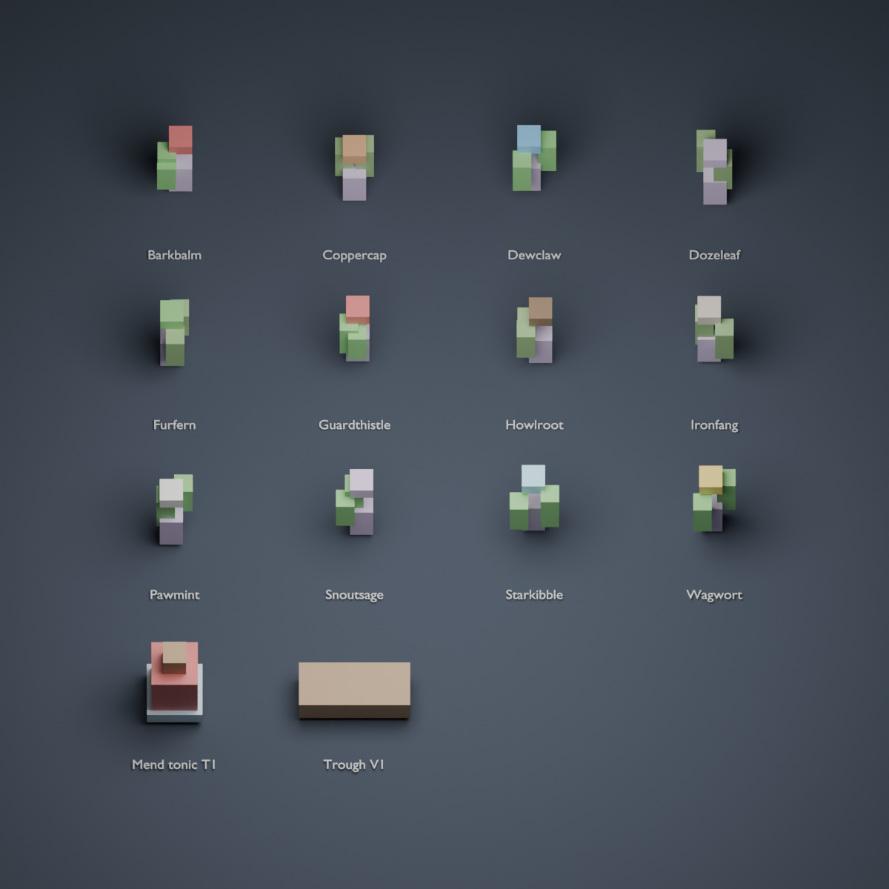

# Existing kennel assets: Blender inventory

Reuses the twelve canonical tonic herbs (Bundle1), Mend tonic T1 and trough V1.
No source GLBs are changed or regenerated. This is an import/geometry and visual inventory,
not proof of Unreal collision, material parity, gameplay tags or tonic effect application.

Run from any working directory with Blender 4.3:

```text
blender --background --factory-startup --python /absolute/repo/tools/asset-audit/kennel_blender_inventory.py -- --output /absolute/output
```

The script uses four CPU threads and 24 Cycles samples, saves an editable `.blend`, renders
a labeled PNG and records JSON source paths, SHA-256 hashes, bytes, mesh counts, triangles
and original imported dimensions in Blender meters. It reads recipe herb names directly
from the canonical tonics.json, so missing source assets fail explicitly.

Display copies are normalized to fit the grid; the report preserves original dimensions.
Source hashes identify exactly which GLBs were inspected. Compare them before reusing a
report after assets change. The script starts from a factory scene in a separate background
Blender process; never execute it inside a Blender session with unsaved work.

Verified 14 imports under Blender 4.3; render inspected for readable labels and uncropped
objects. Recorded evidence:



[Geometry and source hashes](../../docs/benchmarks/kennel-inventory/kennel-inventory.json).
The saved blend stays in the chosen output directory rather than inflating the repository.
